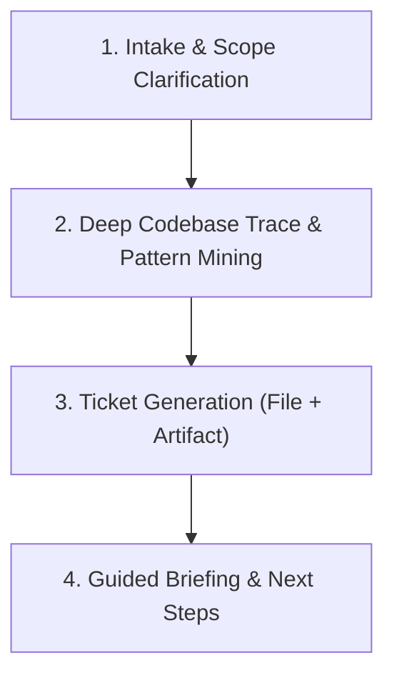

# Guided Dev Ticket Maker (`ticket`)

Transform high-level feature requests, user stories, or bug reports into structured, educational, self-guided developer tickets.

## The Core Problem & Philosophy

When codebases are heavily AI-generated ("vibe-coded") or unfamiliar, developers often lose touch with the underlying architecture, leading to skill atrophy and hesitation when attempting to write code manually.

The purpose of this skill is **not** to write the code for the user.
The purpose is to **scaffold the developer's journey** so they can write clean, idiomatic code themselves with confidence:

1. **Demystify the Domain**: Define business terms, entities, and invariant rules clearly.
2. **Expose the Architecture**: Trace real data flow and pinpoint exact files/symbols.
3. **Teach Local Conventions**: Provide real snippets from the codebase showing how similar tasks are structured so the user can follow established patterns.
4. **Preserve the Challenge with Guarded Scaffolding**: Keep answers folded under progressive 3-tier hints so the user can attempt the solution first and only reveal clues when stuck.
5. **Protect Against Hidden Traps**: Highlight edge cases, subtle side-effects, and legacy quirks common in vibe-coded repos.

---

## Invocation Triggers

Activate this skill when the user says things like:
- "Create a ticket for [feature / bug]"
- "I want to code this myself: [task]"
- "Break down this feature into a guided implementation ticket"
- "Give me a dev ticket with hints for [task]"
- "Teach me where and how to implement [feature] in this repo"
- "Help me understand how to build [X] manually"

---

## Execution Workflow

Follow this 4-phase workflow on every ticket request:



### Phase 1: Intake & Scope Clarification
- Identify the feature or bug to solve.
- Determine whether the ticket is a **Feature**, **Bugfix**, **Refactor**, or **Integration**.
- If crucial domain requirements are missing, ask targeted questions before generating.

### Phase 2: Deep Codebase Trace & Pattern Mining
Before generating the ticket, actively explore the codebase to uncover ground truth:
1. **Entry Points & Routing**: Find the HTTP routes, CLI commands, event listeners, or UI entry points related to the task.
2. **Data Flow Tracing**: Trace the lifecycle: `Route/Controller` ➔ `Middleware/Auth` ➔ `Service/Domain Logic` ➔ `Model/Repository/DB` ➔ `Events/Jobs/Response`.
3. **Pattern Mining**: Find an existing, well-implemented feature in the repository that handles a similar flow (e.g., existing validation form, existing API endpoint, existing service class). Extract relevant snippets as reference models.
4. **Test Suite Discovery**: Identify existing test files, test fixtures, and testing commands used in the project.

### Phase 3: Ticket Generation
1. Determine ticket filename: `.tickets/TASK-<number-or-slug>.md` (create `.tickets/` if it does not exist, or use `tasks/` if already present in repo).
2. Write the complete ticket file to disk.
3. Render the ticket content as a conversation artifact so the user can easily review it in chat.

### Phase 4: Guided Briefing
Present a concise briefing to the user:
- State the ticket ID, title, and saved file path.
- Summarize the core mission in 2–3 sentences.
- Highlight the first milestone for them to start on.
- Remind them that progressive hints are collapsed inside the ticket whenever they need assistance.

---

## Standard Ticket Schema

Every generated ticket must adhere to this comprehensive markdown structure:

```markdown
# TASK-[ID]: [Descriptive Title]

**Type**: [Feature | Bugfix | Refactor | Integration]
**Estimated Complexity**: [Easy | Medium | Hard]
**Target Files**: `path/to/file1.ext`, `path/to/file2.ext`
**Date**: YYYY-MM-DD

---

## 1. 🎯 Mission & Problem Statement
A clear, non-jargon explanation of what needs to be accomplished and why.

### Acceptance Criteria
- [ ] Requirement 1
- [ ] Requirement 2
- [ ] Requirement 3

---

## 2. 🧠 Domain & Business Logic Glossary
Clarify domain terms and business rules so the developer understands *why* things work this way.

| Term / Concept | Plain-English Definition | Invariant / Business Rule |
| :--- | :--- | :--- |
| `[Concept 1]` | What it means in this application | Rule that must never be broken |
| `[Concept 2]` | What it means in this application | Rule that must never be broken |

---

## 3. 🗺️ Code Map & Data Flow
Explain where code lives and how data moves across layers.

### Data Flow Diagram / Pipeline
```
[User Action / Request]
      ⬇
[Entry Point: path/to/file.ext]
      ⬇
[Domain Logic / Service: path/to/service.ext]
      ⬇
[Persistence / Model: path/to/model.ext]
      ⬇
[Side Effect / Event / Response]
```

### Key Files & Symbol Reference
- `path/to/entry.ext`: Responsible for handling the incoming request/action.
  - Look at: `functionName()` or `ClassName`
- `path/to/service.ext`: Core business logic encapsulation.
  - Look at: `handleExecution()`
- `path/to/model.ext`: Data schema and persistence layer.

---

## 4. 📐 Repo Conventions & Idiomatic Patterns to Follow
Show existing, working patterns in this codebase so the developer doesn't have to guess the coding style.

```[language]
// Example from path/to/existing_reference_file.ext
// Note how errors are handled, dependencies injected, and responses formatted:
...
```
> **Key Pattern Takeaways:**
> - How errors are handled in this repo.
> - How validation is performed.
> - How logging or events are dispatched.

---

## 5. 📝 Interactive Implementation Worksheet

### 💭 Pre-Coding Thought Exercises (Answer before writing code)
1. *What happens if input X is invalid or empty?*
2. *Which existing service or helper can I reuse instead of writing from scratch?*
3. *What side effects (emails, webhooks, database writes) need to be triggered?*

### 🔨 Stepped Milestones

#### Milestone 1: [Setup / Data Model / Validation]
- [ ] Step 1.1: ...
- [ ] Step 1.2: ...

#### Milestone 2: [Core Logic / Service Layer]
- [ ] Step 2.1: ...
- [ ] Step 2.2: ...

#### Milestone 3: [Integration / Routing / UI]
- [ ] Step 3.1: ...
- [ ] Step 3.2: ...

---

## 6. 💡 Progressive Hints (Expand only if stuck!)

### Milestone 1 Hints
<details>
<summary>🔍 Level 1: Conceptual Nudge</summary>

Think about where validation happens in this framework before reaching the controller.
</details>

<details>
<summary>🧩 Level 2: Target Files & Method Clues</summary>

Inspect `app/Http/Requests/...` or `src/validators/...`. Check how `ExistingRequest` handles required fields.
</details>

<details>
<summary>📋 Level 3: Pseudocode & Solution Blueprint</summary>

```typescript
// Blueprint example
function validatePayload(data: Input): ValidatedData {
  if (!data.id) throw new ValidationError('Missing ID');
  return { ...data };
}
```
</details>

### Milestone 2 Hints
<details>
<summary>🔍 Level 1: Conceptual Nudge</summary>
...
</details>

<details>
<summary>🧩 Level 2: Target Files & Method Clues</summary>
...
</details>

<details>
<summary>📋 Level 3: Pseudocode & Solution Blueprint</summary>
...
</details>

---

## 7. ⚠️ Traps & Guardrails (Watch out for these!)
- ⚠️ **Trap 1**: Common subtle bug (e.g., forgetting to wrap in a database transaction).
- ⚠️ **Trap 2**: Vibe-coding artifact (e.g., duplicate state variable in store, unindexed query).
- ⚠️ **Trap 3**: Edge case (e.g., timezone differences, null values, concurrency).

---

## 8. 🧪 Verification & Testing Recipes

### Automated Test Command
```bash
# Run tests for this specific feature
pytest tests/test_feature.py
# or
npm test -- path/to/test.spec.ts
# or
php artisan test --filter=FeatureNameTest
```

### Manual Verification Steps
1. Navigate to `http://localhost:3000/...` or invoke `curl ...`
2. Provide test input `...`
3. Observe expected behavior: `...`
4. Inspect database/logs to verify side-effects: `...`

---

## 9. 🎓 Learning Takeaways
What concepts and architectural patterns did this task reinforce?
- Concept 1 (e.g., Idempotency, Repository Pattern, Guard Clauses)
- Concept 2 (e.g., Clean separation of concerns between Transport and Domain logic)
```

---

## Heuristics & Authoring Rules

1. **Do not write the full production code in the main body**: The goal is developer agency. The main body gives the architectural map, patterns, and questions; the code solution lives strictly inside Level 3 collapsible hints.
2. **Always inspect real code first**: Never invent fictitious paths or hallucinated framework methods. Read the project's actual `package.json`, `composer.json`, routes, models, and config files.
3. **Keep Level 1 hints gentle**: Level 1 should challenge the developer to think about architectural concepts without giving away filenames or lines.
4. **Make Level 3 hints idiomatic**: If the developer chooses to open Level 3, the pseudocode or blueprint must strictly match the codebase's conventions, typing rules, and library versions.
5. **Always provide test verification commands**: Give the exact shell command needed to run the test suite for the affected modules.
